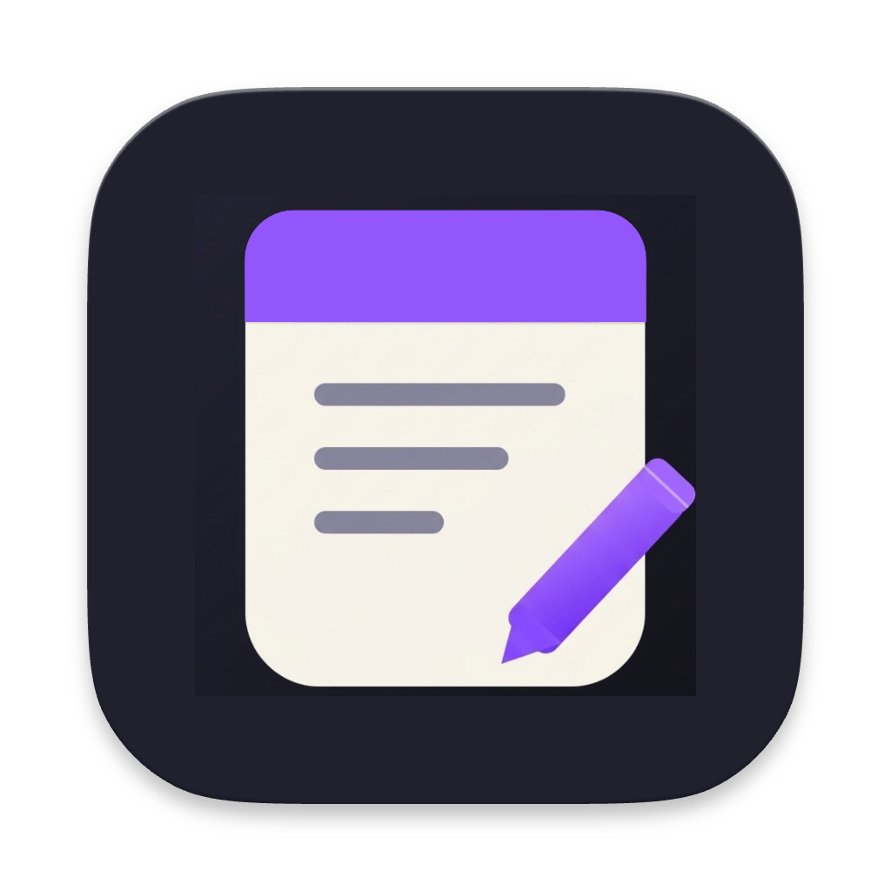

<section class="interactive-hero" aria-label="Portfolio introduction">
  

     DEVELOPER PORTFOLIO / SINGAPORE
    <h1 class="hero-name">Wayne Tay</h1>
    
if you hate it now that its hard, you only liked the fact it was easy.

    
Software · Cybersecurity · Applied Research

    <a class="hero-cta" href="#featured-projects" aria-controls="portfolio-content">View my work ↘</a>
  

</section>

I'm a student developer with **5 years of programming experience** and an interest in software development, cybersecurity, and applied research. I enjoy using technology to solve real-world problems, especially through projects that support the community.

- **Programming:** Python, Swift, and Kotlin
- **Cybersecurity:** Bronze 33 placement in the International Junior Cybersecurity Olympiad
- **Research:** Applied research and school project work
- **Involvement:** SST Inc. and ARC@SST

---

## Featured Projects

A selection of projects I've built and contributed to. Scroll sideways or swipe to explore each project.

  Scroll sideways or swipe to explore projects

  <article class="project-card">
    

      
      

        <h3>quicknote — Native macOS Notes App</h3>
        
Swift · SwiftUI · macOS 13+ · Local persistence

      

    

    
A lightweight notes app for macOS. Visit the quicknote website to see the floating quicknote and full Notepad in action.

    <h4>Features</h4>
    <ul>
      <li><strong>Liquid Glass:</strong> Native glass styling on macOS 26+, with a compatible material fallback on older supported versions.</li>
      <li><strong>Floating quicknote:</strong> Open it with Option–Q; it can sit over other apps, including full-screen Spaces.</li>
      <li><strong>Full Notepad:</strong> Open it with Shift–Option–Q, even when the main window is closed.</li>
      <li><strong>Menu bar access:</strong> quicknote can stay available in the background and launch at login.</li>
      <li><strong>Two independent notes:</strong> The Notepad and quicknote retain separate content.</li>
      <li><strong>Autosave:</strong> Notes persist locally after quitting and reopening the app.</li>
      <li><strong>Privacy-first and offline:</strong> Note contents stay on the Mac and are not sent to a remote server.</li>
      <li><strong>Minimal interface:</strong> A distraction-free notepad and a compact quick-note control.</li>
    </ul>
    
<a class="quicknote-site-cta" href="https://waynetay.github.io/portfolio/quicknote/">Visit the quicknote website ↗</a>

    
<a href="https://github.com/waynetay/quicknote">View repository ↗</a>

    
<a href="https://github.com/waynetay/quicknote/releases/tag/1.4">Download v1.4 ↗</a>

    

      
      
    

  </article>
  <article class="project-card">
    

      

        
      

      

        <h3>TAVAttendance — TAVA × thegoodcompany</h3>
        
SwiftUI · Kotlin · Next.js · Supabase · Collaborative project

      

    

    
Built with three teammates for TAVA, a nonprofit tuition centre. TAVAttendance helps staff track student arrivals, manage attendance and follow up with families.

    <h4>Key features</h4>
    <ul>
      <li><strong>Student check-in:</strong> A shared iPad kiosk records arrivals, flags late students and supports PIN-protected admin overrides.</li>
      <li><strong>Teacher attendance:</strong> Teachers can mark students present, absent or late, view arrival times and attendance history, and save changes offline for later sync.</li>
      <li><strong>Class management:</strong> A web dashboard lets admins manage classes, enrolments and tutor assignments.</li>
      <li><strong>Results and family tools:</strong> Includes result-slip workflows and parent attendance/messaging features, some of which are feature-flagged.</li>
      <li><strong>Multi-platform system:</strong> SwiftUI for iPad, Kotlin/Jetpack Compose for Android, Next.js for the dashboard, and Supabase for the backend.</li>
    </ul>
    
<a href="https://github.com/thegoodcompany-sst/TAVAttendance">View TAVAttendance repository ↗</a>

    
<a href="https://thegoodcompanysg.dev">View team website ↗</a>

    
<a href="https://www.tava.sg">Visit TAVA website ↗</a>

  </article>
  <article class="project-card">
    

      
SMS

      

        <h3>Student Management System</h3>
        
Python · CSV

      

    

    
A Python-based academic data tool that helps organise student results stored in CSV files and turn raw scores into clearer performance summaries. It focuses on the kind of repetitive grade-processing tasks that can otherwise take time to calculate manually.

    <h4>What it does</h4>
    <ul>
      <li><strong>CSV data handling:</strong> Reads and processes student records from structured files.</li>
      <li><strong>Grade lookup:</strong> Retrieves a student's recorded grades when needed.</li>
      <li><strong>Performance summaries:</strong> Calculates individual students' average grades and average grades across courses.</li>
      <li><strong>Score conversion:</strong> Converts marks into Achievement Levels (AL) or alphabet grades for easier interpretation.</li>
    </ul>
    
The project demonstrates practical Python programming, file handling, data processing and the use of calculations to make academic information easier to work with.

    
<a href="https://github.com/Wayne005/Student-Management-Project">View repository ↗</a>

  </article>

---

## Experience and Involvement

### SST Inc.

A member for two years and counting, gaining experience in mobile application development.

- Developed skills in Swift, including advanced programming concepts.
- Gained foundational experience with Kotlin.
- **Community project:** Selected to participate in Project SF in San Francisco, an initiative building applications for nonprofit organisations serving people in need.

### ARC@SST — Applied Research Club

A member of the first batch of ARC@SST, participating in applied research and school activities.

- Helped to host GALESS 2026 and supported school events, including Open House and CCA Fair.
- **Tan Kah Kee Young Inventors’ Award (2026):** Represented my school at the local event through Applied Research Club.
- **Service activities:** Participated in a SEM workshop for NTSS, SST Open House, and a science demonstration outreach at Thye Hua Kwan Family Service Centre – MacPherson.
- Also took part in the **Sec 1 BASE Service Learning Programme** and the **2025 GALESS Singapore Conference**.

---

---

## Achievements

### Cybersecurity

- **International Junior Cybersecurity Olympiad:** Bronze 33 placement.
        

### Academic Awards

  
  
  
  
  

---

## Technical Skills

| Area | Experience |
|---|---|
| Python | Basic to advanced programming, algorithms, data processing and problem-solving |
| Swift | Mobile application development |
| Kotlin | Foundational programming experience |
| Cybersecurity | Participation in an international junior cybersecurity competition |
| Applied Research | Research activities and young inventors' competitions |

---

## Courses and Certifications

### Python Programming

Completed three Python programming courses.

- **[Python Basic Certificate](https://drive.google.com/file/d/1dGVgOLhJNbmEaooJqr7THHNGReKWevQV/view?usp=sharing):** Variables, conditional statements, loops, and fundamental problem-solving skills.
- **[Python Intermediate Certificate](https://drive.google.com/file/d/1WwniuBjwVl92bOIZeUX6wWhrB4E1rayP/view?usp=sharing):** Lists, functions, modules, search algorithms, and intermediate problem-solving.
- **[Python Advanced Certificate](https://drive.google.com/file/d/1dQt8kFBQD5luMZRsqgFJK-VYazzBxrWb/view?usp=sharing):** Searching and sorting algorithms, input parsing, and advanced techniques involving lists, functions, and dictionaries.

### Python Hackathon

Participated in a Python hackathon involving programming fundamentals, including conditional statements, loops, lists, functions, dictionaries, list comprehensions, and searching and sorting algorithms.

### Google Applied Digital Skills

[View Applied Digital Skills Certificates](https://drive.google.com/drive/folders/1mqsUeLbupJW3bIGpuwfIankx0mz0M8g2?usp=drive_link)

---

## Currently Learning

I'm continuing to develop my programming skills through collaborative projects, applied research, and exploration of cybersecurity and software development.

## Contact

- **GitHub:** [@waynetay](https://github.com/waynetay)
- **Personal Email:** [waynetay811@gmail.com](mailto:waynetay811@gmail.com)
- **School Email:** [tay_an_zhi_wayne@ssts.edu.sg](mailto:tay_an_zhi_wayne@ssts.edu.sg)

