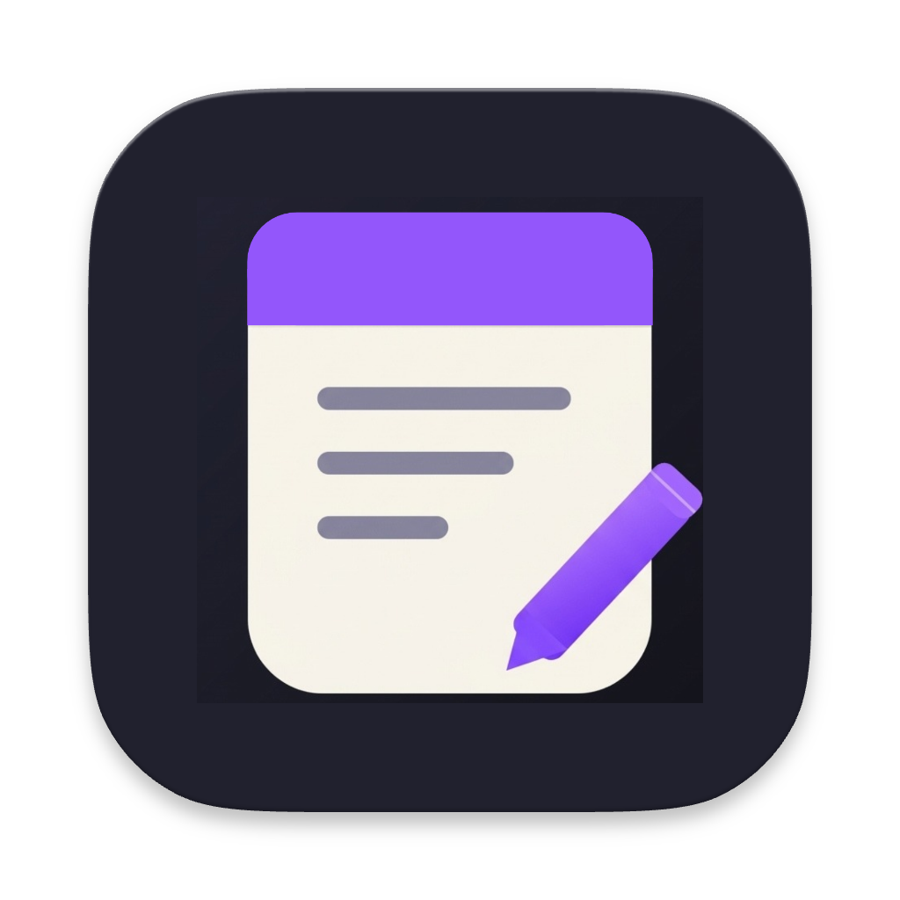

I'm a student developer with **5 years of programming experience** and an interest in software development, cybersecurity, and applied research. I enjoy using technology to solve real-world problems, especially through projects that support the community.

- **Programming:** Python, Swift, and Kotlin
- **Cybersecurity:** Bronze 33 placement in the International Junior Cybersecurity Olympiad
- **Research:** Experience in applied research and participation in the Tan Kah Kee Young Inventors' Award
- **Involvement:** SST Inc. and ARC@SST

---

## Featured Projects

### quicknote — Native macOS Notes App

  

**Version:** v1.2  
**Language:** Swift, SwiftUI  
**Platform:** macOS 13 Ventura and later

quicknote is a minimalist native macOS notes app with two independent writing spaces: a spacious notepad and a compact floating Quick Note. Its dark interface uses Apple's Liquid Glass design on macOS 26+, with a material-based fallback on macOS 13–25.

**Features**
- **Liquid Glass:** Native glass styling on macOS 26+, with a compatible material fallback on older supported versions.
- **Floating Quick Note:** A compact window designed to stay above other windows, making it useful while browsing or working.
- **Two independent notes:** The main Notepad and Quick Note retain separate content.
- **Autosave:** Notes persist locally after quitting and reopening the app.
- **Privacy-first and offline:** Note contents stay on the Mac and are not sent to a remote server.
- **Minimal interface:** A distraction-free notepad and a compact quick-note control.

**Repository:** [View quicknote on GitHub](https://github.com/waynetay/quicknote)  
**Portfolio:** [waynetay.github.io/portfolio](https://waynetay.github.io/portfolio/)

#### Screenshots

  
  

---

### TAVAttendance — TAVA × thegoodcompany

**Language:** Swift 

A collaborative project developed with three other team members to support TAVA, a nonprofit organisation, with its logistical needs.

- Focuses on developing practical software solutions for a real-world organisation.
- Part of an initiative to use technology to support community service.

**Repository:** [TAVA × thegoodcompany](https://github.com/thegoodcompany-sst)

---

### Student Management System

**Language:** Python, CSV

A student grade management application designed to help teachers analyse student performance and manage academic results.

**Features include:**
- Reading and processing student data from CSV files.
- Calculating individual students' average grades.
- Calculating average grades across courses.
- Retrieving a student's grades.
- Converting scores into Achievement Levels (AL) or alphabet grades.

**Repository:** [View on GitHub](https://github.com/Wayne005/Student-Management-Project)

---

## Experience and Involvement

### SST Inc.

[Visit SST Inc.](https://www.sstinc.org)

A member for two years and counting, gaining experience in mobile application development.

- Developed skills in Swift, including advanced programming concepts.
- Gained foundational experience with Kotlin.
- Selected to participate in **Project SF in San Francisco**, part of an initiative focused on building applications for nonprofit organisations serving people in need.

### ARC@SST — Applied Research Club

[Visit ARC@SST](https://www.sst.edu.sg/applied-research-club-arc-sst/)

A member of the first batch of ARC@SST, participating in applied research and school activities.

- Helped to host GALESS 2026.
- Supported school events, including Open House and CCA Fair.
- Contributed to service activities.

---

## Achievements

### Cybersecurity

- **International Junior Cybersecurity Olympiad:** Bronze 33 placement.

### Taekwondo

- **Singapore Taekwondo Federation Poom 1:** Awarded on 18 April 2021.
- [View Certificate](https://drive.google.com/file/d/1F4Jrqddo1XEp6kBksI6pMsvIzaTxAKm7/view?usp=sharing)

### Academic Awards

- [Edusave Certificate of Academic Achievement 2021](https://drive.google.com/file/d/13v4U1EePJa2iz3OSBa3FEcC_AtVcz4ez/view?usp=sharing)
- [Edusave Certificate of Academic Achievement 2022](https://drive.google.com/file/d/1wORXn-IGtX-5c9DnIYzqm9u74HWrUszf/view?usp=sharing)
- [Education Merit Award 2022](https://drive.google.com/file/d/1cCqGZaIMWQMYWtb4rDKcsaGLWLpfqPga/view?usp=sharing)
- [Edusave Certificate of Academic Achievement 2023](https://drive.google.com/file/d/18zNMwwIXhKTkP1U0Sht0a6X8qY7iA0Kh/view?usp=sharing)
- [Edusave Merit Bursary 2023](https://drive.google.com/file/d/1sm-piSqrv3Rb-sqzw69u9snZO7M7Mi7M/view?usp=sharing)

---

## Technical Skills

| Area | Experience |
|---|---|
| Python | Basic to advanced programming, algorithms, data processing and problem-solving |
| Swift | Mobile application development |
| Kotlin | Foundational programming experience |
| Cybersecurity | Participation in an international junior cybersecurity competition |
| Applied Research | Research activities and young inventors' competitions |

---

## Courses and Certifications

### Python Programming

Completed three Python programming courses.

- **[Python Basic Certificate](https://drive.google.com/file/d/1dGVgOLhJNbmEaooJqr7THHNGReKWevQV/view?usp=sharing):** Variables, conditional statements, loops, and fundamental problem-solving skills.
- **[Python Intermediate Certificate](https://drive.google.com/file/d/1WwniuBjwVl92bOIZeUX6wWhrB4E1rayP/view?usp=sharing):** Lists, functions, modules, search algorithms, and intermediate problem-solving.
- **[Python Advanced Certificate](https://drive.google.com/file/d/1dQt8kFBQD5luMZRsqgFJK-VYazzBxrWb/view?usp=sharing):** Searching and sorting algorithms, input parsing, and advanced techniques involving lists, functions, and dictionaries.

### Python Hackathon

Participated in a Python hackathon involving programming fundamentals, including conditional statements, loops, lists, functions, dictionaries, list comprehensions, and searching and sorting algorithms.

### Google Applied Digital Skills

[View Applied Digital Skills Certificates](https://drive.google.com/drive/folders/1mqsUeLbupJW3bIGpuwfIankx0mz0M8g2?usp=drive_link)

---

## Currently Learning

I'm continuing to develop my programming skills through collaborative projects, applied research, and exploration of cybersecurity and software development.

## Contact

- **GitHub:** [@waynetay](https://github.com/waynetay)
- **Personal Email:** [waynetay811@gmail.com](mailto:waynetay811@gmail.com)
- **School Email:** [tay_an_zhi_wayne@ssts.edu.sg](mailto:tay_an_zhi_wayne@ssts.edu.sg)
